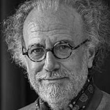

# Eyeglass Finder

**A needle-in-a-haystack search: it finds people wearing eyeglasses in Wikipedia images, in a dataset whose publishers ran a face detector to leave out images where a face covers more than 10% of the picture. It runs ~21× faster after tuning and moving to the M2 Max GPU (10.6 → 225 images/sec).**

| | | |
|:---:|:---:|:---:|
|  |  |  |
|  |  |  |

<sub>Six finds from the showcase run (eyeglasses score 1.00, all confirmed in the blind visual review): face crops cut from Wikimedia Commons images. Credits: [`CREDITS.md`](CREDITS.md).</sub>

**Browse the 38 confirmed finds scored 0.97 or above:** [Finds gallery](https://alpha-w0lf.github.io/eyeglass_finder/docs/latest_run_showcase/qualitative_analysis/final_targets/index.html) · [Near misses below the cutoff](https://alpha-w0lf.github.io/eyeglass_finder/docs/latest_run_showcase/qualitative_analysis/false_negative_candidates/index.html)

## Results (showcase run `run_2026-10-19_01-20-39`)

| Metric | Value |
|---|---|
| Throughput | **225 images/sec** (~21× the 10.6 images/sec Docker CPU baseline) |
| Images scanned | 39,258 (2 WIT shards) in 174 s |
| Images with no face detected | 31,990 (81.5%) |
| Faces detected | 15,465 |
| Faces ≥ 100 px, classified | 414 |
| **Faces with eyeglasses (score ≥ 0.90)** | **44** |
| Confirmed in a blind AI visual review | 43 of 44 finds ([review labels](docs/latest_run_showcase/visual_review.csv)) |
| Decode errors | 0 |

A second blind AI review sampled rejected faces: among the faces it judges (100 px and up), the pipeline finds an estimated 74% of eyeglass wearers (56–86%). Faces under 100 px are skipped by design.

<sub>How the 74% is estimated: 43 confirmed finds against the eyeglass wearers among rejected faces (2 of 18 near misses, plus 4 of 110 randomly drawn rejected faces across both reviews, scaled to the 352 rejected faces outside the near-miss band), with a 95% Wilson interval on the sampled miss rate carried through to recall. The second review also checked the 84 finds an earlier run with a box-size bug kept that this run does not: 59 are real photos of people in eyeglasses. With the corrected boxes, 56 of them are not among the faces this run judges (smaller than 100 px, or not detected) and 3 were judged and rejected (their scores in this run are in the CSV's `score_in_2026_run` column); the CSV lists the earlier run's box sizes. All 162 labels are in [`visual_review_2.csv`](docs/latest_run_showcase/visual_review_2.csv).</sub>

<sub>Provenance: both numbers are end-to-end runs on the same M2 Max, each with a committed report. The showcase report names commit `e20624b`, from the development history before this repository's single-commit public release. The 10.6 baseline is the pre-tuning code (August 2025) in Docker on the CPU, 4,000 images ([`docs/baseline_run/report.md`](docs/baseline_run/report.md), 10.58). The 225 figure is the tuned code on the GPU, 39,258 images from the same two shards ([`docs/latest_run_showcase/report.md`](docs/latest_run_showcase/report.md), 225.05). 225.05 / 10.58 = 21.27.</sub>

<sub>Blind visual review: 112 crops: 44 finds, 18 near misses scored 0.60–0.89 (the near-miss page lists the top 20; its last two score 0.597 and 0.598, shown rounded as 0.60), and 50 random rejected faces, reviewed by a fresh AI reviewer agent, with every label written before the scores were revealed, 2026-10-19. All 112 labels are in [`visual_review.csv`](docs/latest_run_showcase/visual_review.csv).</sub>

## The problem

The source is Wikimedia's WIT image dataset. For privacy, its publishers left out images where a person is the primary subject, meaning a face covers more than 10% of the picture as measured by their RetinaFace detector ([dataset card](https://huggingface.co/datasets/wikimedia/wit_base)). Measured with this pipeline's own face boxes (a different detector from the publishers' RetinaFace), the finds cover 10-17% of their pictures (median 13%). In the showcase run the face detector found no face at all in 81% of the 39,258 images. The pipeline has to find the faces that remain, at speed, keep those large enough to judge (at least 100 px), and decide which ones wear eyeglasses.

## How it works


Stage 1 (`scripts/process_data.py`) runs the models, saves every candidate face, then builds the report. Stage 2 (`scripts/generate_run_artifacts.py`) does the filtering and reporting and can be re-run alone, so a new threshold or plot needs no new model pass. Hardware is picked automatically: NVIDIA CUDA, then Apple MPS, then CPU (`src/utils/device.py`).

## Key engineering decisions

1. **Two models, two stages.** YOLOv8-Face detects the faces. A pre-trained eyeglasses classifier ([`glasses-detector`](https://github.com/mantasu/glasses-detector)) scores each face that is at least 100 px. Each model can be swapped or retuned on its own, and the expensive model pass is stored so filtering and reporting re-run without it.
2. **Native Apple GPU, tuned for throughput: ~21×.** I moved from CPU-only Docker to the native Apple GPU (MPS), batched face detection, scaled to 10 worker processes, and added memory-aware prefetching so long runs stay stable. A test pins Apple-GPU face boxes to the CPU result, so a framework upgrade cannot silently change the data funnel (it runs on Macs with Apple GPUs and is skipped when the face-detector weights are not downloaded, as in CI).
3. **Every run reports on itself.** Each run writes a data funnel, timings, CPU and memory plots, and browsable galleries of the finds and the near misses, so every result can be reviewed visually.

## Try it

Needs Python 3.12 and Poetry. The face-detector weights download on first run and are checked against a pinned SHA-256.

```bash
poetry install
poetry run pytest -q        # unit tests, CPU only, no data needed
# Download train-00000-of-00330.parquet and train-00001-of-00330.parquet
# from https://huggingface.co/datasets/wikimedia/wit_base/tree/main/data into data/raw/
poetry run python scripts/process_data.py --config config/production.yaml
```

The run writes `outputs/run_<timestamp>/` with `report.md`, `filtered_dataset.parquet`, plots and galleries. Docker setup (portable, CPU only on macOS) and every config option: [`docs/TECHNICAL.md`](docs/TECHNICAL.md).

**Stack:** Python 3.12 · PyTorch 2.6 · Ultralytics YOLOv8-Face · glasses-detector · pandas / Parquet · pytest + ruff in GitHub Actions · Docker · Poetry

## Deeper docs

| Path | What it holds |
|---|---|
| `docs/latest_run_showcase/` | The full report, plots and galleries from the showcase run |
| `docs/post_run_report.md` | How the pipeline went from 10.6 to 225 images/sec |
| `docs/TECHNICAL.md` | Setup, design choices, output schemas |
| `dataset_card.md` | Output dataset schema and statistics |
| `config/production.yaml` | The tuned config used for the showcase run |
| `src/`, `scripts/`, `tests/` | Pipeline code, Stage 1 and Stage 2 entry points, unit tests |
| `AGENTS.md` | Commands and rules for coding agents working in this repo |

**How this was built:** AI-native. Coding agents write code under my plans and review, following [`AGENTS.md`](AGENTS.md). Unit tests and lint run in CI on every pull request and every push to `main`.

**Credits and license:** The showcase face crops come from public Wikimedia Commons / WIT images; see [`CREDITS.md`](CREDITS.md). Code and docs: GNU AGPL-3.0 ([`LICENSE`](LICENSE)), the same licence as the Ultralytics library the pipeline runs on.

Built by Thomas Chacko, Senior AI Engineer (Ex-Meta). [LinkedIn](https://www.linkedin.com/in/tchacko1/)
