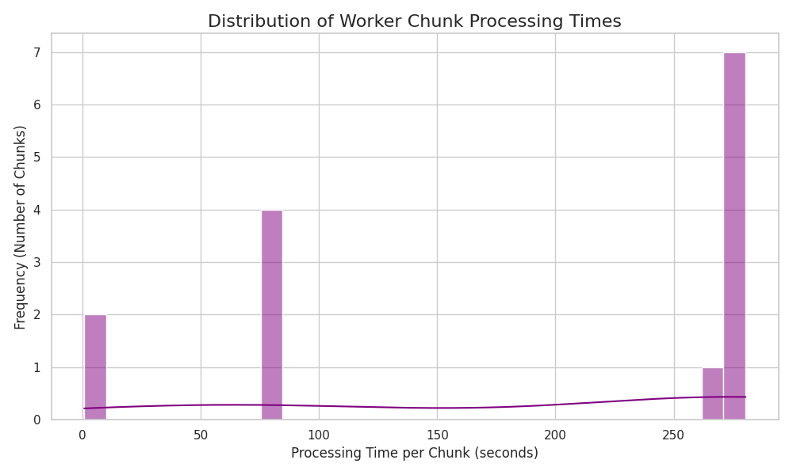
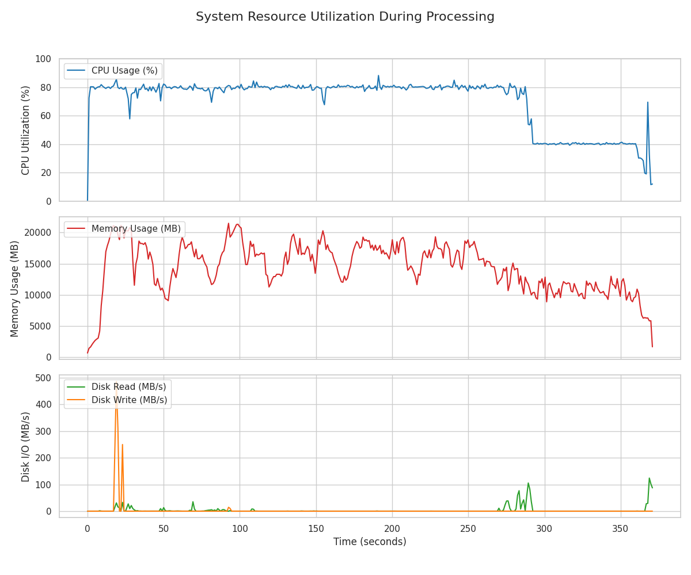
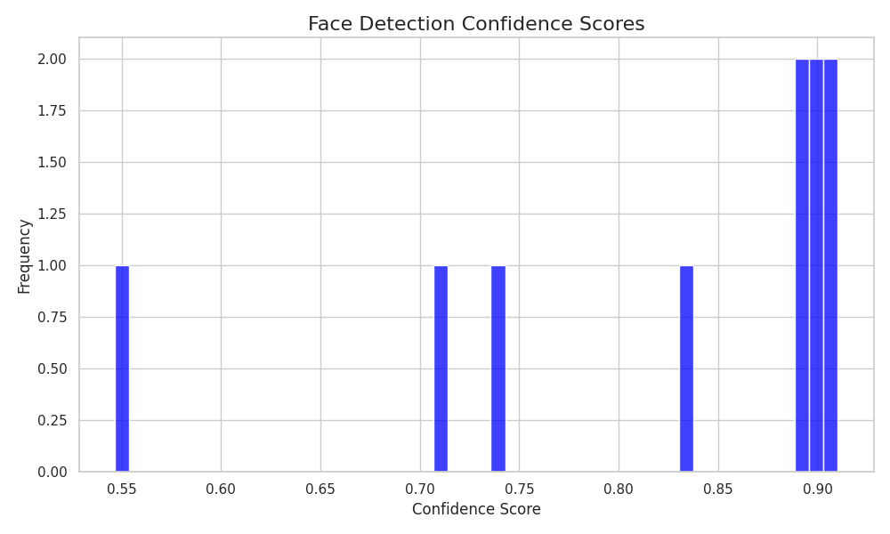
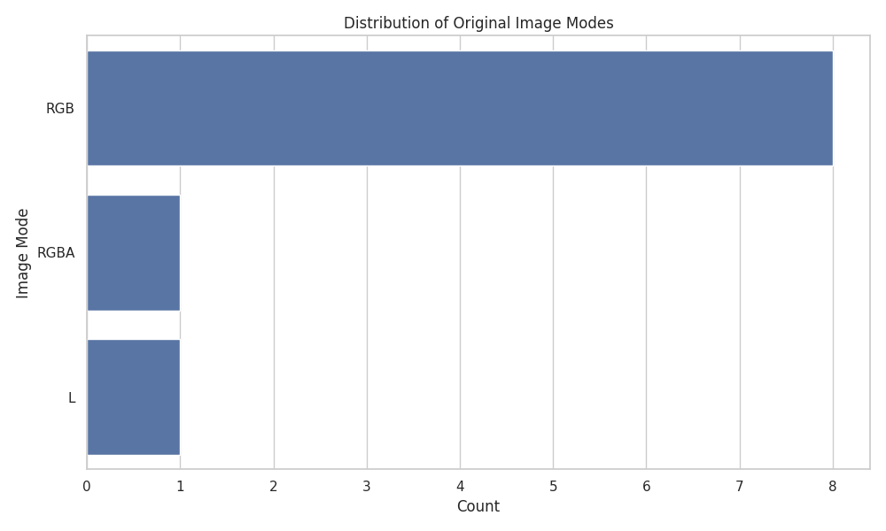
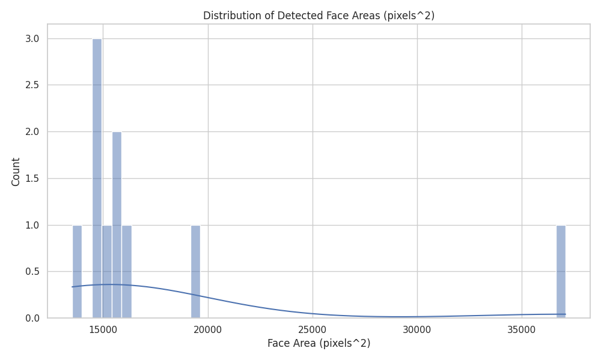
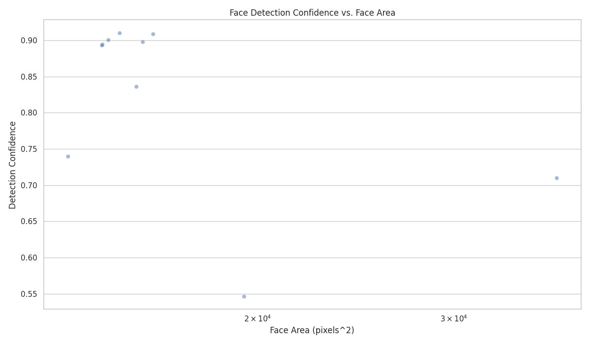
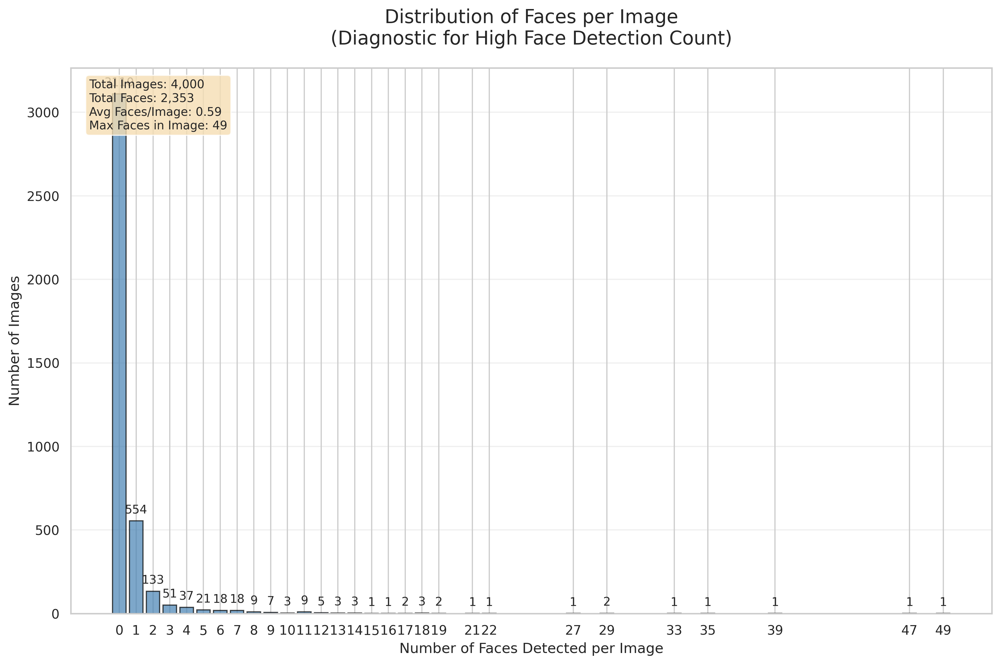

# Docker CPU Baseline Re-measure: run_2026-10-19_16-57-37

This re-measures the Docker CPU baseline (9.8 images/sec in the original August 2025 run) with the code that baseline ran.

| Item | Value |
|---|---|
| Result | **10.58 images/sec**: 4,000 images in 378.1 s (pipeline timer; 389 s for the whole container run) |
| Code | Commit `1a6c8aa` ("Checkpoint: Before Phase 1 optimization", 2025-08-16), the code in effect for the 2025 baseline run `2025-08-16_17-26-06`. Only change: the Dockerfile base image `python:3.12-slim-bullseye` → `python:3.12-slim-bookworm` (bullseye's packages are no longer served) |
| Config | That commit's own `config/config.yaml`: 8 workers, chunk size 333, face-detector confidence 0.50 (echoed in full below) |
| Image set | `data/test_2`: the first 2,000 rows of each of the two WIT shards `train-00000-of-00330.parquet` and `train-00001-of-00330.parquet` (4,000 images), the same files the 2025 run used (dated June 2025; checked row by row against the shards). Rebuild with `python scripts/create_test_dataset.py --input-dir data/raw --output-dir data/test_2 --sample-size 2000` |
| Machine | Apple M2 Max MacBook Pro, Docker Desktop (Docker Engine 29.9.1), CPU only: Docker on macOS has no GPU access |
| Docker limits | 10 CPUs, 23,049,838,592 bytes (21.47 GiB) memory, as reported by `docker info` |
| Peak memory | 20.1 GiB (container, `docker stats` sampled about once a second) |
| Date | 2026-10-19 |

**Differences from the 2025 run**
- Docker memory: 28 GB in 2025 (per the August 2025 planning notes, not in this repository), 21.47 GiB here. The 2025 CPU limit is not recorded. The same code ran out of memory at 7.75 GiB.
- OS layer: Debian 12 (bookworm) here, Debian 11 (bullseye) in 2025. Python packages come from the same 2025 lock file.
- The 2025 notes give a peak of about 3 GB; this run peaked at 20.1 GiB, so that 2025 figure measured something else; what it measured is not recorded.

The run's own report follows, unchanged apart from removing links to crops and galleries that are not committed.

---

# Pipeline Run Report: run_2026-10-19_16-57-37

## 1. Run Summary
- **Git Commit Hash:** `1a6c8aa-bookworm`
- **Run Command:** `scripts/process_data.py`
- **Environment:**
```json
python_version: 3.12.15

```

## 2. Performance Dashboard
| Metric                    | Value      |
| ------------------------- | ---------- |
| Total Runtime (seconds)   | 378.1 |
| Images per Second         | 10.58     |
| Total Detection Time (s)  | 599.51 |
| Total Classification Time (s)| 1.88 |

#### 2.1. Worker Performance
| Metric (per chunk)            | Value      |
| ----------------------------- | ---------- |
| Avg. Processing Time (s)      | 181.07 |
| Std. Dev. Processing Time (s) | 112.2 |
| Min. Processing Time (s)      | 0.76 |
| Max. Processing Time (s)      | 280.45 |



### 2.2. System Resource Utilization


## 3. Data Funnel
| Stage                               | Count      |
| ----------------------------------- | ---------- |
| Total Images Processed              | 4000 |
| Images with Decoding Errors         | 0 |
| Images with No Faces                | 3110 |
| Images with Faces                   | 890 |
| Total Faces Detected                | 2353 |
| Faces > Size Threshold              | 41 |
| Faces Classified                    | 41 |
| Faces with Eyeglasses (Predicted)   | 10 |
| Faces Rejected as Sunglasses        | 3 |
| **Final Target Faces**              | **7** |

### 3.1. Face Detection Diagnostics

**Key Findings:**
- **Maximum faces in single image:** 49
- **Images with multiple faces:** 336
- **Average faces per image (images with faces):** 2.64

**Face Count Distribution:**
**Face Count Distribution Summary:**
- **Images with no faces:** 3,110 (77.8%)
- **Images with 1 face:** 554 (13.9%)
- **Images with 2-5 faces:** 242 (6.0%) - *Small groups*
- **Images with 6+ faces:** 94 (2.4%) - *Group photos/crowd scenes*
- **Highest concentration:** 49 faces in a single image

*See visualization below for complete distribution pattern.*

**Investigation Note:** The high face detection count (2353 total faces) warrants investigation.

### 3.2. Pipeline Robustness

**Failure Tracking:**
- **Failed Inference Batches:** 0
- **Corrupted Image Batches:** 0 
- **Images in Corrupted Batches:** 0
- **Individual Decoding Errors:** 0

*These metrics help diagnose pipeline robustness and identify potential issues with batch processing, memory pressure, or data quality.*

## 4. Model Quality Analysis

### 4.1. Distributions

| Face Detection Confidence | Original Image Modes |
| :---: | :---: |
|  |  |

| Face Size Distribution | Confidence vs. Face Size |
| :---: | :---: |
|  |  |

### 4.3. Face Count Distribution (Diagnostic)



This plot shows the distribution of how many faces were detected per image. The high total face count (2353 faces) can be analyzed by examining this distribution to identify if the pipeline is processing many group photos, crowd scenes, or experiencing false positives.

### 4.4. Qualitative Samples

The run's face crops and galleries are not committed for this baseline run.

## 5. Full Configuration (`config.yaml`)
```yaml
paths:
  input_dir: data/test_2
  output_dir: outputs/run_2026-10-19_16-57-37
  output_filename: filtered_dataset.parquet
  logs_dir: outputs/run_2026-10-19_16-57-37/logs
data_processing:
  file_pattern: sample_train-*.parquet
  chunk_size: 333
model_params:
  face_detection:
    model_path: models/yolov8n-face-lindevs.pt
    min_face_size: 100
    min_confidence: 0.5
    keep_all: false
    target_size:
    - 224
    - 224
  classification:
    present_label: present
    output_image_format: JPEG
execution:
  num_workers: 8
  diagnostic_serial_mode: false
  inference_batch_size: 64
logging:
  level: INFO
  format: '<green>{time:YYYY-MM-DD HH:mm:ss}</green> | <level>{level: <8}</level>
    | <cyan>{name}</cyan>:<cyan>{function}</cyan>:<cyan>{line}</cyan> - <level>{message}</level>'
report_generation:
  qualitative_analysis_sample_size: 20
run_id: run_2026-10-19_16-57-37

```
